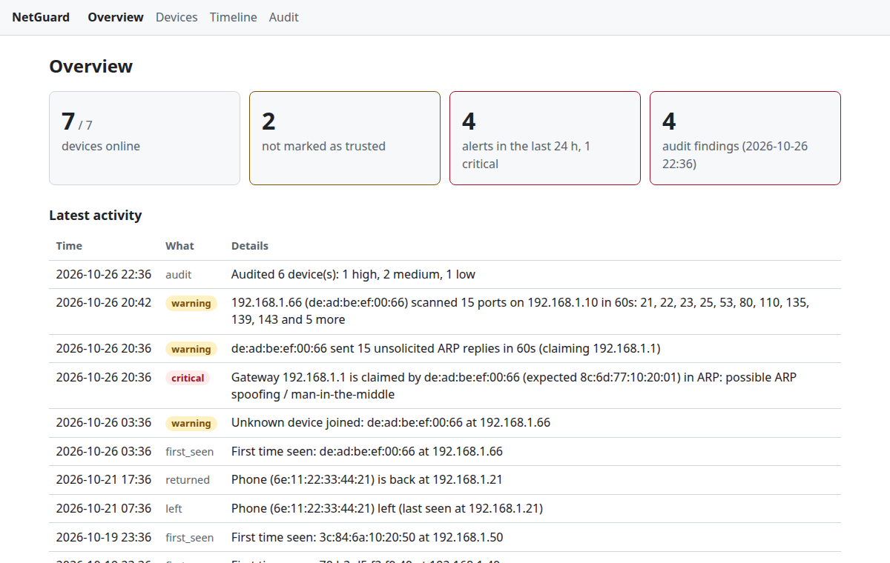
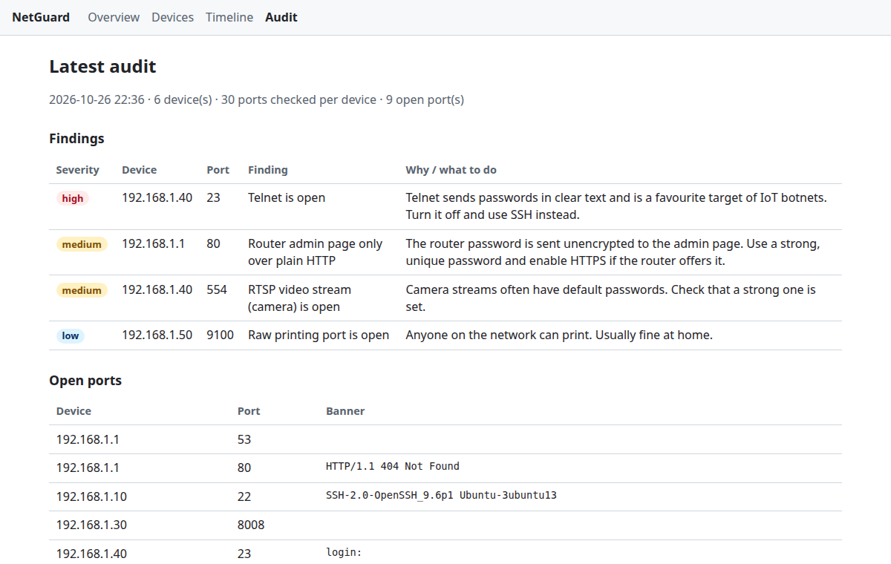

# NetGuard

[](https://github.com/Tanzeel0Hussain/netguard/actions/workflows/ci.yml)

**A home network security monitor written in Python and Scapy.**

NetGuard watches your own local network the way a small blue-team sensor would:
it keeps an inventory of every device, warns you when an unknown device joins,
detects ARP spoofing / man-in-the-middle attempts and port scans, and audits
your own devices for risky open services. A local web dashboard shows it all.

> **Scope:** NetGuard is a defensive tool for networks you own or administer.
> It refuses to scan public IP ranges or networks larger than a /20.

**New here? Read the step-by-step guide: [docs/USAGE.md](docs/USAGE.md).** It
covers what NetGuard can do, how to do each task, and what every alert means.





*Screenshots use the made-up data from `netguard demo`.*

## Status

| Feature | Status |
|---|---|
| Device discovery (active ARP scan + passive ARP cache) | ✅ M1 |
| Device inventory in SQLite, trust/label devices | ✅ M1 |
| Alert when an unknown device joins | ✅ M1 |
| MAC vendor lookup, randomised-MAC detection, device labels | ✅ M2 |
| Continuous monitoring, presence timeline, JSON-lines log, notify hook | ✅ M3 |
| ARP spoofing / MITM detection (live or from a pcap) | ✅ M4 |
| Port-scan and host-sweep detection | ✅ M5 |
| Device audit: open ports, banners, risky services, Markdown/HTML report | ✅ M6 |
| Local web dashboard and JSON API | ✅ M7 |
| systemd services, demo data, screenshots, v0.1.0 | ✅ M8 |

See [docs/ROADMAP.md](docs/ROADMAP.md) for the full plan.

## Install

Requires Linux and Python 3.11+.

```bash
git clone https://github.com/Tanzeel0Hussain/netguard.git
cd netguard
python3 -m venv .venv
.venv/bin/pip install -e ".[dev]"
```

## Usage

```bash
# What network will NetGuard watch?
.venv/bin/netguard info

# Passive discovery: read the kernel's ARP cache (no root needed)
.venv/bin/netguard scan --passive

# Active ARP scan of the whole subnet (needs root or CAP_NET_RAW)
sudo .venv/bin/netguard scan

# Inventory, trust your own devices, and review alerts
.venv/bin/netguard devices
.venv/bin/netguard trust 52:54:00:a1:b2:c3 --label "My phone"
.venv/bin/netguard label 8c:6d:77:ab:cd:01 "Router"
.venv/bin/netguard devices --untrusted
.venv/bin/netguard alerts

# Keep watching: scan every 5 minutes, report devices joining, leaving, returning
sudo .venv/bin/netguard monitor --interval 300
.venv/bin/netguard timeline

# Watch for ARP spoofing / man-in-the-middle and port scans
sudo .venv/bin/netguard watch
.venv/bin/netguard watch --pcap capture.pcap --gateway 192.168.1.1   # offline, no root
.venv/bin/netguard gateway list

# Audit your own devices for open ports and risky services (no root needed)
.venv/bin/netguard audit --report audit.html
.venv/bin/netguard audit --target 192.168.100.1 --ports 1-1024

# Dashboard on http://127.0.0.1:8080/ (devices, timeline, latest audit)
.venv/bin/netguard web

# Optional: download the MAC vendor list once (resumes if the connection drops)
.venv/bin/netguard oui update
.venv/bin/netguard oui lookup 8c:6d:77:ab:cd:01
```

Example:

```
$ sudo .venv/bin/netguard scan
Scanning 192.168.100.0/24 on wlp0s20f3 (active ARP scan)...
Found 3 device(s).
IP              MAC                VENDOR                        STATUS   LABEL
--------------  -----------------  ----------------------------  -------  --------
192.168.100.1   8c:6d:77:ab:cd:01  Huawei Technologies Co.,Ltd   trusted  Router
192.168.100.73  6e:11:22:33:44:73  (randomised MAC)              trusted  My phone
192.168.100.66  de:ad:be:ef:00:01                                NEW
[!] Unknown device joined: de:ad:be:ef:00:01 at 192.168.100.66
```

The first scan is a **baseline**: everything it finds is recorded without
alerts. From then on, any MAC address that is not in the inventory raises a
`new_device` alert.

### Monitoring

`netguard monitor` scans on an interval until you press Ctrl+C (or systemd
sends SIGTERM). One failed scan, for example while Wi-Fi reconnects, is logged
and the monitor carries on.

- A device counts as **left** only after it has not answered for
  `away_after` (15 minutes by default), so a phone that skips one ARP reply in
  power-saving mode does not flap. Only an active scan can say that a device
  left; the passive ARP cache can only show that one is there.
- Every alert and event is appended to `~/.local/share/netguard/events.jsonl`,
  one JSON object per line, ready for `jq` or a SIEM such as Splunk or ELK.
- The same alert for the same device is not repeated within `dedup_window`.
- Set `[alerts] command = ["notify-send", "NetGuard"]` to get a desktop
  notification per alert. Under sudo the command runs as you, not as root.

### ARP spoofing detection

ARP has no authentication: any host can answer "the gateway is at my MAC",
and victims then send their traffic through it (man-in-the-middle).
`netguard watch` captures ARP packets and raises:

| Alert | Severity | Meaning |
|---|---|---|
| `gateway_mac_changed` | critical | The gateway IP is claimed by a MAC not accepted for this access point |
| `ip_mac_changed` | warning | An IP that belonged to one device is claimed by another |
| `mac_claims_many_ips` | warning | One MAC answers for several IPs within a minute |
| `arp_reply_flood` | warning | One MAC keeps sending ARP replies nobody asked for (how `arpspoof` keeps a cache poisoned) |

At start-up it also checks the gateway entry already in the kernel's ARP cache,
so a cache that was poisoned before NetGuard started is caught too.

**Roaming without false alarms.** Homes with two routers or mesh access points
share one gateway IP across different MACs. The accepted gateway MACs are
stored per Wi-Fi access point (BSSID, read with `iw` or `nmcli`), so moving to
another floor is not an attack. The first MAC seen as the gateway on a new
access point is learned (trust on first use, like SSH's `known_hosts`); use
`netguard gateway allow <mac>` to accept another one.

**What one sensor can see.** On Wi-Fi and switched networks, ARP replies are
unicast. A laptop running NetGuard sees broadcasts, gratuitous ARP and the
replies sent to itself, so it reliably detects attacks against itself and
broadcast poisoning, but not an attack between two other devices. Run it on an
always-on machine, or use a mirror port, to watch more.

### Port-scan detection

The same `netguard watch` also captures TCP SYN packets without ACK (new
connection attempts; the kernel filter drops everything else) and raises:

| Alert | Trigger (defaults) |
|---|---|
| `port_scan` | one source sends SYNs to 15+ different ports of one host within 60 s (e.g. `nmap -sS`) |
| `host_sweep` | one source sends SYNs to the same port on 10+ hosts within 60 s |

Browsing opens many connections but to few ports, so it stays quiet. This
machine is never flagged (so NetGuard's own audit does not alert), and
`[portscan] allow` lists other scanners you run yourself. State is kept for
at most 10,000 sources, so a scan from spoofed addresses cannot exhaust
memory. Very slow scans (`nmap -T1`) stay below any sensible threshold and are
out of scope. Only IPv4 is covered for now.

### Device audit

`netguard audit` checks the devices in your inventory (all online ones by
default) for open TCP ports, reads what each service says about itself, and
explains what is risky:

```
$ netguard audit --target 192.168.100.1 --report audit.html
Auditing 1 device(s), 30 port(s) each...
IP             PORT  SERVICE  BANNER
-------------  ----  -------  ----------------------
192.168.100.1  53    DNS
192.168.100.1  80    HTTP     HTTP/1.1 404 Not Found
[MEDIUM] 192.168.100.1:80 Router admin page only over plain HTTP
```

- It is a **TCP connect scan** (no root, no crafted packets) of 30 common
  home-network ports by default, or `--ports 1-1024` / `--ports 22,80,443`
  (at most 1024 per device). Connections are limited (`--concurrency`, default
  100) and time out after `--timeout` seconds.
- **Banners:** services like SSH and FTP announce themselves; on web ports
  NetGuard sends a single `HEAD /` request and reads the `Server` header. On
  TLS ports it only checks that a handshake works. Nothing else is ever sent:
  no logins, no exploits.
- **Rules** flag, for example, Telnet, VNC and databases reachable from the
  network (high), FTP, SMB, RDP, camera streams, TR-069 and a router admin
  page without HTTPS (medium), and OpenSSH older than 8.0 (low), each with a
  short "why it matters / what to do".
- Only devices already in the inventory can be audited, and public addresses
  are refused: this is for your own network.
- Reports are Markdown or a standalone HTML page (`--report audit.md|html`),
  and every audit is saved to the database and noted on the timeline.
- UDP services (e.g. UPnP/SSDP on 1900, DNS over UDP) are not checked.

### Dashboard

`netguard web` serves a read-only dashboard on `http://127.0.0.1:8080/` with
an overview, the device list, the timeline and the latest audit, plus a JSON
API (`/api/devices`, `/api/alerts`, `/api/timeline`, `/api/audit`). Pages
refresh every 30 seconds and need no JavaScript.

It has no login, so it refuses to listen on anything but a loopback address.
It also rejects requests whose `Host` header is not `localhost` or a loopback
IP, which stops DNS-rebinding attacks from web pages you visit. Text that comes
from the network (banners, names) is escaped, and responses carry a strict
Content-Security-Policy.

`--pcap` replays a capture (e.g. from `tcpdump -w`) through the same detector.
It needs no root and writes nothing, which makes it handy for forensics.

### Try it without a network

```bash
netguard demo                                   # writes netguard-demo/
netguard --db netguard-demo/netguard.db web     # a week of made-up history
netguard watch --pcap netguard-demo/arp-spoof.pcap --gateway 192.168.1.1
netguard watch --pcap netguard-demo/port-scan.pcap
```

The demo holds six devices, a phone leaving and coming back, an unknown
device that joins, tries ARP spoofing and port-scans the laptop, and an audit
with findings. The two captures are recordings of an `arpspoof`-style attack
and an `nmap -sS` scan. Nothing in it describes a real device.

### Run it all the time (systemd)

[packaging/systemd/](packaging/systemd/) has three services: `monitor`,
`watch` and `web`. They run as your user, not as root. The capture services
get only `CAP_NET_RAW` and `CAP_NET_ADMIN`, inside a sandbox where the system
and your home folder are read-only except NetGuard's data folder.

```bash
sudo cp packaging/systemd/netguard-*@.service /etc/systemd/system/
sudo systemctl daemon-reload
sudo systemctl enable --now netguard-monitor@$USER netguard-watch@$USER netguard-web@$USER
journalctl -u netguard-watch@$USER -f          # follow the alerts
```

The files expect NetGuard in `~/netguard` with its virtual environment in
`~/netguard/.venv`; edit `ExecStart` if yours is elsewhere.

### Configuration

Everything is auto-detected, but you can pin settings in
`~/.config/netguard/netguard.toml` (see
[netguard.example.toml](netguard.example.toml)) or pass `--config`.
The database lives in `~/.local/share/netguard/netguard.db` by default (also
when run with `sudo`, and the file stays owned by you).

## How it works

```
 Sources                    Core                        Output
 ARP scan (Scapy) ─┐   ┌─ detectors (pure functions) ─┐
 /proc/net/arp ────┼──▶│                              ├──▶ CLI / alerts / dashboard
 sniffer (M4+) ────┘   └─ SQLite inventory & alerts ──┘
```

- **Active discovery** broadcasts one ARP "who-has" request per address in the
  subnet with Scapy and records every reply. ARP works below IP, so devices
  with a firewall that drops ping still answer.
- **Passive discovery** reads `/proc/net/arp`, the kernel's cache of hosts it
  has recently talked to. It sends no packets and needs no root.
- **Vendor lookup** matches the MAC against the IEEE OUI assignments
  (Wireshark's `manuf` list), longest prefix first, because the IEEE hands out
  24-, 28- and 36-bit blocks. MACs with the *locally administered* bit set are
  shown as randomised: phones make these up per Wi-Fi network for privacy, so
  they have no vendor.
- **Detectors** are pure functions (observations in, alerts out). They do no
  I/O, so they are tested with fake data and recorded packets, without root or
  a live network.
- **Safety checks** reject public or oversized targets before any packet is sent.

## Project layout

```
src/netguard/
  cli.py          command line (argparse)
  config.py       TOML config
  models.py       Observation, Device, Alert
  netinfo.py      interface/subnet detection and scope checks
  storage.py      SQLite inventory, scans and alerts
  engine.py       runs detectors on a scan and saves the results
  monitor.py      the scan loop behind `netguard monitor`
  alerting.py     console output, JSON-lines log and command hook
  sensor/         sniffer.py: live capture (ARP + TCP SYN) and pcap replay (Scapy)
  audit/          scanner.py (asyncio connect scan), rules.py, report.py
  web/            Flask dashboard: templates/, static/
  demo.py         made-up data and attack captures for `netguard demo`
  oui.py          MAC vendor lookup and resumable download
  discovery/      arp_scan.py (active), arp_table.py (passive)
  detectors/      new_device.py, presence.py, arp_spoof.py, portscan.py
packaging/systemd/  services for monitor, watch and web
tests/            pytest suite, no root or network needed
```

## Development

```bash
.venv/bin/pytest
```

## License

MIT © Tanzeel Hussain
